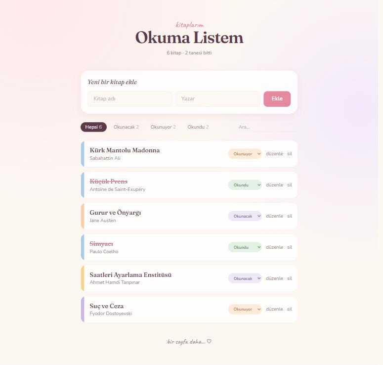

# Okuma Listem

React ile yaptığım basit bir okuma listesi uygulaması. Okumak istediğim kitapları ekleyip durumlarını (Okunacak / Okunuyor / Okundu) takip edebiliyorum. TODO uygulaması mantığında hazırlandı.

**Canlı Demo:** _Netlify linki buraya eklenecek_



## Kullanılanlar

- React 19
- Google Fonts (Fraunces, Nunito, Caveat)
- Vite
- Tailwind CSS
- LocalStorage (veriler tarayıcıda saklanıyor)
- Netlify (yayınlama)

## Özellikler

- **Ekleme:** kitap adı ve yazar girilerek yeni kitap eklenir
- **Listeleme:** tüm kitaplar listelenir, duruma göre filtrelenebilir ve arama yapılabilir
- **Güncelleme:** "Düzenle" ile kitap adı/yazar değiştirilir, açılır menüden durum değiştirilir
- **Silme:** "Sil" butonu ile kitap listeden kaldırılır
- Sayfa yenilense bile veriler kaybolmaz (LocalStorage)

## Kurulum

```bash
git clone https://github.com/serra0781/OkumaListem-React.git
cd OkumaListem-React
npm install
npm run dev
```

Tarayıcıda `http://localhost:5173` adresini aç.

Yayın için build almak:

```bash
npm run build
```

Çıktı `dist` klasörüne oluşur.

## Klasör yapısı

```
src/
  components/   -> BookForm, BookList, BookItem, FilterBar
  pages/        -> HomePage (ekle/güncelle/sil işlemleri burada)
  interfaces/   -> kitap nesnesinin yapısı ve durumlar
  utils/        -> localStorage okuma/yazma
  App.jsx
  main.jsx
```

## Netlify'a yükleme

Repo Netlify'a bağlandığında `netlify.toml` dosyası sayesinde build komutu (`npm run build`) ve yayın klasörü (`dist`) otomatik ayarlanır.
